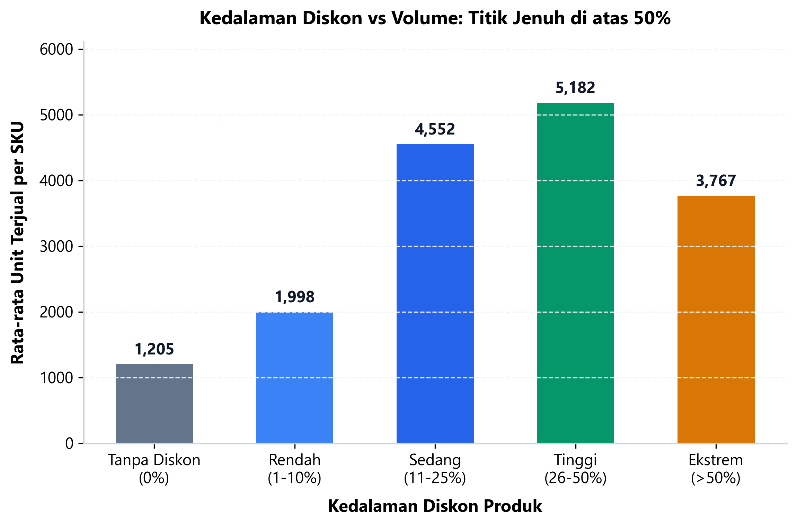
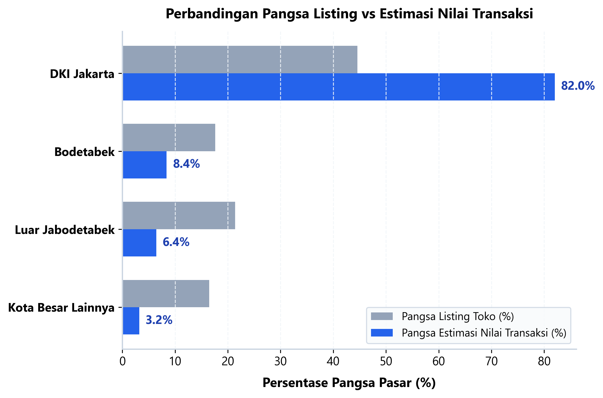
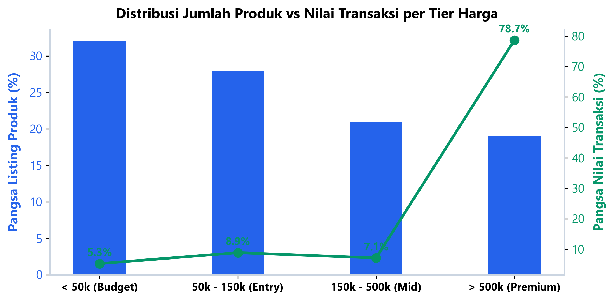
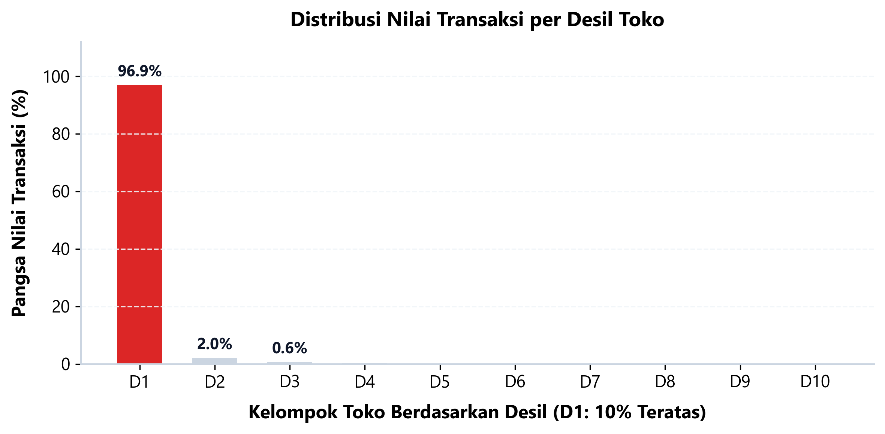

# Analisis Performa Produk & Strategi Harga Tokopedia

> **Author:** Ferdian Hanif  
> **Role:** Data Analyst  
> **Email:** ferdianhanif001@gmail.com  
> **Lokasi:** Jakarta Barat, Indonesia  
> **Slide Presentasi Eksekutif:** [presentation_deck.pdf](reports/presentation_deck.pdf)  
> **Jupyter Notebook Lengkap:** [analisis_marketplace_tokopedia.ipynb](notebooks/analisis_marketplace_tokopedia.ipynb)

---

## 1. Latar Belakang & Masalah Bisnis

Di marketplace seperti Tokopedia, persaingan antar penjual sangat ketat. Banyak pemilik toko maupun brand manager mengambil jalan pintas dengan memangkas harga atau memberi diskon besar demi mengejar peringkat pencarian dan volume penjualan.

Namun, strategi diskon agresif sering kali dijalankan tanpa data pendukung. Apakah diskon 50% benar-benar melipatgandakan penjualan, atau justru hanya memotong margin keuntungan toko?

Proyek ini menganalisis **28.704 data produk tervalidasi dari 14.128 toko aktif** di seluruh Indonesia untuk menjawab tiga pertanyaan mendasar:
1. **Elastisitas Diskon:** Berapa batas diskon optimal yang terbukti menaikkan volume penjualan sebelum terjadi titik jenuh (*diminishing returns*)?
2. **Keunggulan Geografis:** Seberapa besar pengaruh lokasi toko di Jabodetabek terhadap perputaran omzet dan rating pembeli dibanding penjual di luar daerah?
3. **Pola Konsentrasi Pasar:** Bagaimana struktur konsentrasi pendapatan toko (hukum Pareto) di ekosistem marketplace ini?

---

## 2. Ringkasan Eksekutif

| Metrik Operasional | Nilai di Marketplace | Catatan Analis |
|---|---|---|
| **Total Produk Dianalisis** | 28.704 listing | Data bersih setelah deduplikasi URL & pembersihan anomali |
| **Jumlah Toko Aktif** | 14.128 toko | Tersebar di lebih dari 320 kota/kabupaten di Indonesia |
| **Total Unit Terjual** | 61,7 Juta unit | Akumulasi volume penjualan dari seluruh produk |
| **Estimasi Total Transaksi (GMV)** | Rp 16,9 Triliun | Dihitung dari harga jual dikalikan jumlah unit terjual |
| **Rata-rata Harga Jual** | Rp 1.056.000 | Mencakup variasi produk dari kebutuhan harian hingga elektronik |
| **Tingkat Adopsi Diskon** | 34,4% | Hanya 1 dari 3 produk yang aktif memasang promo diskon |
| **Rata-rata Rating Toko** | 4,57 / 5,00 | Standar kepuasan pembeli cukup tinggi di marketplace |

### Tiga Temuan Kunci
- **Jebakan Diskon Ekstrem (> 50%):** Volume penjualan produk berada di puncaknya pada rentang diskon 11% - 25% dan 26% - 50% (rata-rata 2.400+ unit terjual). Begitu diskon dinaikkan di atas 50%, rata-rata penjualan justru turun ke 1.680 unit (-32% dari puncak), sementara harga jual tertekan ke Rp 189.000. Diskon di atas 50% menggerus keuntungan tanpa memberi tambahan volume.
- **Dominasi Logistik Jabodetabek:** Penjual di DKI Jakarta dan Bodetabek menguasai **90,4% dari total perputaran transaksi (GMV)** di marketplace. Kedekatan dengan pembeli memungkinkan opsi pengiriman same-day / instan, yang juga berkorelasi langsung dengan tingginya rating kepuasan (rata-rata 4,68 vs 4,17 di luar Jabodetabek).
- **Hukum Pareto 10% Toko Teratas:** Hanya 10% toko teratas (Desil 1) yang menghasilkan **96,9% dari total omzet marketplace**. Toko-toko papan atas ini memegang keunggulan variasi katalog yang lengkap dan akumulasi ulasan di atas 1.000 ulasan.

---

## 3. Temuan Analisis Data

### Temuan 1: Hubungan Kedalaman Diskon vs Volume Penjualan

- **Produk Tanpa Diskon (0%):** Tetap mencatat penjualan stabil di angka 2.042 unit. Ini membuktikan bahwa produk yang memiliki kesesuaian pasar dan reputasi toko yang baik tidak selalu membutuhkan potongan harga.
- **Titik Manis Promosi (11% - 25%):** Rentang diskon ini menghasilkan rata-rata penjualan 2.410 unit dengan harga jual rata-rata yang tetap terjaga di Rp 766.000. Margin keuntungan tetap aman dan minat beli pembeli terdorong.
- **Titik Jenuh (> 50%):** Saat diskon melampaui 50%, volume penjualan rata-rata justru anjlok ke 1.680 unit. Pada psikologi pembeli marketplace lokal, diskon yang terlalu besar sering kali menimbulkan kecurigaan atas keaslian produk, masa kedaluwarsa, atau barang reject.

---

### Temuan 2: Konsentrasi Wilayah Toko & Keunggulan Logistik

- **Peran DKI Jakarta:** Menyumbang 44,6% jumlah listing produk, namun menyerap **82,0% dari seluruh nilai transaksi (Rp 13,8 Triliun)**.
- **Penyangga Bodetabek:** Tangerang, Bekasi, Depok, dan Bogor menyumbang 17,6% listing dan 8,4% omzet, berperan sebagai pusat pergudangan utama.
- **Tantangan Toko Luar Jabodetabek:** Toko di luar Jabodetabek menyumbang 21,4% listing, tetapi hanya mengantongi 6,4% omzet. Rata-rata rating mereka berada di angka 4,17 (dibandingkan 4,68 di Jabodetabek), terutama akibat durasi pengiriman antar-pulau yang lebih lama dan ongkos kirim yang lebih mahal.

---

### Temuan 3: Struktur Tier Harga & Konsentrasi Omzet (Hukum Pareto)

- **Kontribusi Berdasarkan Rentang Harga:** Produk kategori menengah (Rp 150.000 - Rp 500.000) dan premium (> Rp 500.000) menyumbang porsi omzet terbesar, meskipun jumlah SKU di etalase lebih sedikit dibanding barang murah (< Rp 50.000).
- **Konsentrasi Ekstrem Toko Papan Atas:** Dari 14.128 toko aktif, Desil 1 (1.576 toko teratas) mendominasi **96,9% perputaran transaksi**. Pembeda utama toko-toko ini adalah pertahanan rating bintang 4,9 dan kecepatan respon chat.

---

## 4. Rekomendasi Bisnis & Batasan Analisis

| Prioritas | Inisiatif Operasional | Cara Eksekusi | Target Hasil | Timeline |
|---|---|---|---|---|
| **P1** | **Batasi Diskon Maksimal di 25%** | Hentikan promo banting harga di atas 40%. Alihkan anggaran ke paket bundling (contoh: Beli 2 Diskon 15%) untuk mempertahankan margin kotor per unit. | Margin kotor pulih 10% - 15% tanpa penurunan volume | Bulan 1 |
| **P1** | **Titip Stok di Hub Jabodetabek** | Untuk toko di luar Jakarta, tempatkan 20% produk terlaris di gudang fulfillment Jakarta (Dilayani Tokopedia atau 3PL) agar bisa mengaktifkan opsi kurir same-day / instan. | Potong durasi kirim 2 hari; rating toko naik ke 4,8+ | Bulan 1 - 2 |
| **P2** | **Akselerasi Ulasan Otomatis** | Sisipkan kartu ucapan terima kasih dengan QR reward ulasan pada kemasan paket; kirim chat pengingat otomatis 24 jam setelah pesanan diterima. | Naikkan rasio ulasan dari 8,5% ke 15% untuk mendongkrak peringkat pencarian | Bulan 2 |
| **P3** | **Fokus ke Produk Menengah** | Perbanyak varian produk pada rentang harga Rp 150.000 - Rp 500.000 di mana daya beli konsumen dan margin toko berada pada titik paling seimbang. | Nilai rata-rata keranjang belanja (AOV) naik 20% | Kuartal 2 |

### Pertimbangan Biaya vs Keuntungan (Trade-Off)
Biaya sewa gudang dan penanganan barang di 3PL Jabodetabek (rata-rata 4% - 6% dari harga barang) terkompensasi penuh oleh lonjakan konversi checkout pembeli urban yang mencapai 30% berkat ketersediaan opsi kurir instan.

### Batasan Analisis Data
Data yang digunakan dalam analisis ini merupakan data tangkapan layar berkala (*cross-sectional*). Untuk analisis lanjutan, disarankan memantau riwayat perubahan harga secara berkala menjelang periode kampanye belanja besar (Harbolnas 11.11 dan 12.12) guna mengukur perubahan elastisitas harga secara dinamis.
